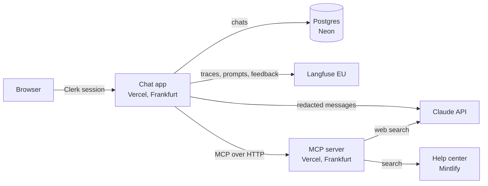

Proxi is a monorepo with three apps: the chat app, an MCP tool server, and this help center.

## Components

| Component | Role | Built with |
|---|---|---|
| Chat app | The interface and its API: chat, saved chats and feedback | Vue 3, Vercel serverless functions |
| Sign-in | Accounts and sessions, checked on every API request | Clerk |
| Model | Generates replies and decides when to call tools | Claude (Opus, Sonnet, Haiku) |
| MCP server | Exposes tools to the agent: `web_search`, `search_docs` and `get_status`. Web search runs through Claude with Anthropic's web search tool | MCP TypeScript SDK, Streamable HTTP |
| Database | Stores each user's chats, already redacted | Postgres on Neon |
| Observability | Traces, tool call spans, the system prompt and feedback scores | Langfuse |
| Help center | These docs, also the source the agent searches | Mintlify |

## How a message flows

<Steps>
  <Step title="Sign-in check">
    The API verifies the Clerk session token and applies the per-user rate limit.
  </Step>
  <Step title="Redaction and file checks">
    Card numbers, IBANs, emails and phone numbers are redacted. Attachments are checked by their contents, and risky PDFs are refused.
  </Step>
  <Step title="Tool discovery">
    The chat app connects to the MCP server and turns its tools into Claude tool definitions. Tool inputs are redacted before they're sent.
  </Step>
  <Step title="Agent loop">
    Claude streams its reply. When it calls a tool, the app runs it through MCP and returns the result, up to five rounds.
  </Step>
  <Step title="Citations">
    Results from `search_docs` become numbered links in the reply and a Sources list.
  </Step>
  <Step title="Save and trace">
    The redacted chat is saved to Postgres, and the whole exchange, including tool calls, is traced in Langfuse.
  </Step>
</Steps>

## Deployment

- The chat app and the MCP server are separate Vercel projects, both in the Frankfurt region.
- The help center is deployed by Mintlify from `apps/docs`.
